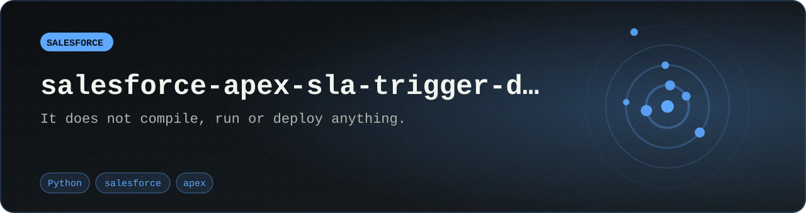
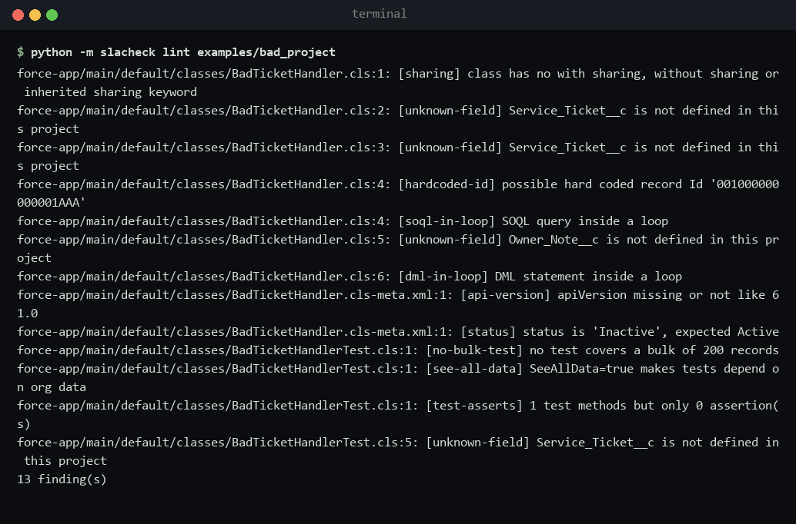

<p align="center"></p>

# salesforce-apex-sla-trigger-demo

[](https://github.com/yassine2med/salesforce-apex-sla-trigger-demo/actions/workflows/ci.yml)  

An Apex trigger, a service class and a test class that stamp SLA timestamps on a service ticket custom object: opened time, due time by priority, resolved time and whether the SLA was met. A small Python tool, `slacheck`, reads the Apex source and checks it for common mistakes. It does not compile, run or deploy anything.



## What it is for

Facility and service desk teams promise response times by priority. This demo shows the standard, bulk safe way to compute them in Salesforce: a thin trigger that calls a handler class, no queries and no DML inside loops, and tests that cover a bulk of 200 records. Salesforce admins and developers can copy the pattern. The Python checker flags the usual Apex review points in any project laid out like this one.

## Install

```
git clone https://github.com/yassine2med/salesforce-apex-sla-trigger-demo
cd salesforce-apex-sla-trigger-demo && pip install -r requirements.txt
```

The Apex code under `force-app/` is a standard Salesforce DX project (source API version 61.0). It has not been deployed or run in an org by this repo; the Apex tests are written to be run with `sf apex run test` in your own scratch org.

## How to use

| I want to | Command |
|---|---|
| Lint the demo project (prints "0 finding(s)", exit code 0) | `PYTHONPATH=src python -m slacheck lint .` |
| Lint the deliberately bad sample and see every finding | `PYTHONPATH=src python -m slacheck lint examples/bad_project` |
| Print the SLA hours table read from the Apex class | `PYTHONPATH=src python -m slacheck table` |
| Work out a due time for a priority | `PYTHONPATH=src python -m slacheck due --priority High --opened "2026-11-20 09:00"` |
| Show help | `PYTHONPATH=src python -m slacheck --help` |

Exit codes: 0 when clean, 1 when findings exist, 2 for a missing folder, missing file or bad input.

Example:

```
PYTHONPATH=src python -m slacheck lint examples/bad_project
```

Output:

```
force-app/main/default/classes/BadTicketHandler.cls:1: [sharing] class has no with sharing, without sharing or inherited sharing keyword
force-app/main/default/classes/BadTicketHandler.cls:2: [unknown-field] Service_Ticket__c is not defined in this project
force-app/main/default/classes/BadTicketHandler.cls:3: [unknown-field] Service_Ticket__c is not defined in this project
force-app/main/default/classes/BadTicketHandler.cls:4: [hardcoded-id] possible hard coded record Id '001000000000001AAA'
force-app/main/default/classes/BadTicketHandler.cls:4: [soql-in-loop] SOQL query inside a loop
force-app/main/default/classes/BadTicketHandler.cls:5: [unknown-field] Owner_Note__c is not defined in this project
force-app/main/default/classes/BadTicketHandler.cls:6: [dml-in-loop] DML statement inside a loop
force-app/main/default/classes/BadTicketHandler.cls-meta.xml:1: [api-version] apiVersion missing or not like 61.0
force-app/main/default/classes/BadTicketHandler.cls-meta.xml:1: [status] status is 'Inactive', expected Active
force-app/main/default/classes/BadTicketHandlerTest.cls:1: [no-bulk-test] no test covers a bulk of 200 records
force-app/main/default/classes/BadTicketHandlerTest.cls:1: [see-all-data] SeeAllData=true makes tests depend on org data
force-app/main/default/classes/BadTicketHandlerTest.cls:1: [test-asserts] 1 test methods but only 0 assertion(s)
force-app/main/default/classes/BadTicketHandlerTest.cls:5: [unknown-field] Service_Ticket__c is not defined in this project
13 finding(s)
```

SLA hours: Critical 4, High 8, Normal 24, Low 72. A blank or unknown priority uses Normal.

Run the tests with `python -m pytest -q`.

## How it works

1. `ServiceTicketSlaTrigger` runs before insert and before update and passes the records to `ServiceTicketSlaService`. It holds no logic.
2. On insert the service stamps the opened time if blank and sets the due time from the priority table.
3. On update it recalculates the due time when the priority changes, stamps the resolved time when the status becomes Resolved, and sets `Sla_Met__c`.
4. `slacheck` strips comments and string contents, finds loop bodies, and reports queries or DML inside them, hard coded record Ids, missing sharing keywords, logic in triggers, thin tests, missing meta files, wrong names and fields not defined under `objects/`.

## Limits

- The checker is heuristic text analysis, not an Apex parser. It can miss problems and can flag odd code that is fine.
- The Apex has not been compiled or run by this repo. Test it in your own org before relying on it.
- Business hours, holidays and pauses are not modelled; the due time is simple clock hours.

## License

MIT. Yassine Emhamed, 2026.
